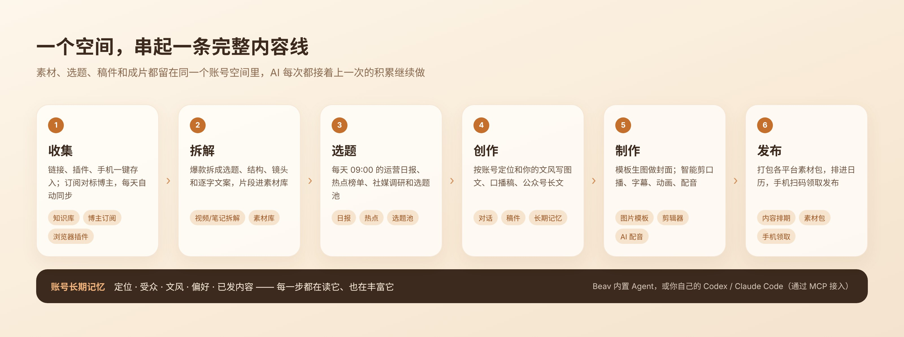
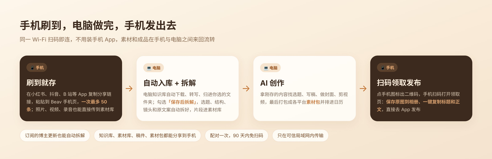
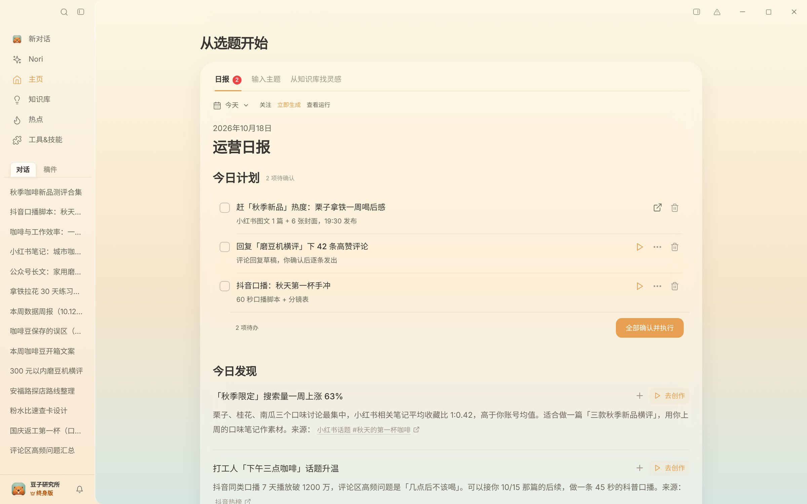

  

<h1 align="center">Beav</h1>

  <strong>AI 自媒体工作台</strong>

  <!-- maintenance-days:start -->
  
  <!-- maintenance-days:end -->

  <!-- release-stats:start -->
  
  
  <!-- release-stats:end -->

从资讯与选题，到图文创作、口播剪辑和持续运营的一站式 AI 工作空间。

本地优先 · 账号长期记忆 · AI 图片与视频剪辑 · macOS / Windows / Linux

  
  
  
  
  
  

  <a href="https://beav.pro/download"><strong><big>官网高速下载</big></strong></a>

  <a href="https://www.bilibili.com/video/BV1pnpz6rETV/">视频教程</a>

  

> RedBox 已更名为 **Beav**；原有本地数据和工作空间不受影响。

## 做自媒体，时间都去哪了？

| 你每天遇到的麻烦 | Beav 的做法 |
| --- | --- |
| 手机上刷到好内容只能收藏，回到电脑就找不到了 | 在手机上粘贴分享链接，一键存进**电脑知识库**，视频自动下载转写，需要时点一下**拆解**成选题、结构、镜头和逐字文案 |
| 对标账号一天看一遍，看完就忘 | **订阅博主**，新内容每天自动同步入库 |
| 每天早上不知道写什么 | 每天 09:00 生成**运营日报**和今日计划，**热点**页按你的账号方向给各平台热榜打分 |
| 通用 AI 写出来的东西没有“你”的味道 | 每个账号一个**空间**，定位、受众、文风、偏好和已发内容都进长期记忆，AI 每次接着上次的积累写 |
| 写完稿还要去别的软件做封面、剪视频、配字幕 | 同一个对话里写稿、用**图片模板**生图、在**剪辑器**里智能剪口播、加字幕和动画、AI 配音 |
| 发布前在电脑和手机之间来回传图、复制文案 | 稿件自动打包成各平台**素材包**，排进**内容日历**，手机扫码直接领取图片和文案 |
| 已经在用 Codex、Claude Code，不想再换一个 AI | 一键**接入 Agent**，让你常用的 AI 直接读写 Beav 的素材库、知识库和稿件 |

Beav 不是又一个聊天框，而是一个为内容创作者准备的、会越用越懂你的**素材库 + 运营工作台**。

## 一条完整的内容线

  

## 手机刷到，电脑做完，手机发出去

灵感大多是在手机上刷到的，创作却要在电脑上完成，最后又得回到手机发布。Beav 把这条路打通了：手机和电脑连同一个 Wi-Fi，扫一下二维码就能互传，不用装手机 App。

  

1. **手机刷到，一键存到电脑**：在电脑知识库点「手机上传」，手机扫码打开「保存到知识库」页面。之后在小红书、抖音、B 站、YouTube、微博、知乎、公众号等 App 里复制分享链接，粘贴进来就行，连分享文案一起粘也没关系，一次最多 50 条。手机相册里的照片、视频和录音也能直接传进素材库。配对一次，90 天内收藏页面地址就能直接打开。
2. **存进来，想拆就拆**：电脑会自动下载、转写；对想学的内容点「拆解」，就能拆成选题、结构、镜头节奏、拍摄脚本和带时间的原文案。订阅的博主一更新就自动入库。
3. **在电脑上用 AI 创作**：拿刚存的内容找选题、写稿、做封面、剪视频，最后打包成各平台的素材包。
4. **扫码到手机发布**：在素材包、稿件或知识库卡片上点手机图标，手机扫码打开领取页，原图保存到相册，标题和正文一键复制，直接去 App 发布。图片、视频、文档和整个文件夹也都能这样分享到手机。

<table>
  <tr>
    <td width="50%"></td>
    <td width="50%"></td>
  </tr>
  <tr>
    <td align="center">手机刷到：扫码配对，粘贴链接存到电脑</td>
    <td align="center">电脑做完：扫码到手机，保存原图、复制文案去发布</td>
  </tr>
</table>

## 打开主页，就知道今天做什么

主页把一天的工作放在一屏里：

- **会话看板**：AI 在后台干活，你只看三栏。「等你处理」是 AI 停下来问你的问题，「待查看」是做完等你验收的结果，「进行中」是还在跑的任务。点开卡片，会话在右侧抽屉里继续聊，不用离开主页。
- **内容排期**：本周要发什么、哪篇还是初稿、哪篇过了计划日还没发，一眼看清；可在月 / 周 / 年视图之间切换，拖动即可改期，节日和节气会标在日历上方便借势。
- **小工具**：常用的小工具和你让 AI 做出来的专属小工具，都在顶部一键打开。

  

<table>
  <tr>
    <td width="50%"></td>
    <td width="50%"></td>
  </tr>
  <tr>
    <td align="center">月视图：排期、状态与当天产出</td>
    <td align="center">点开会话，在右侧抽屉里直接验收和继续聊</td>
  </tr>
</table>

## 找选题：日报、热点和你的账号对得上

- **运营日报**：每天 09:00 结合你的账号方向，整理今日计划和值得跟进的发现，每条都带来源链接，点「去创作」就开一个新对话。
- **热点**：「适合我的账号」按匹配度给全网热点打分，并标出它在各平台榜单上的位置；右侧并排展示小红书、抖音、B 站、微博、知乎、百度、头条等热榜。看到合适的，直接发起 AI 讨论或存进选题池。

  

  

## 写稿：懂你账号的 AI 写手

在新对话里说出目标即可，例如「用知识库里的秋季新品调研，写一篇小红书笔记」。AI 会读取你存过的资料和账号档案，按平台写出完整作品：标题、正文、话题标签，必要时连配图一起生成，最后交付一个可以直接发布的**素材包**，在对话右侧就能预览、标记已发布或去发布。

- **步骤可见**：每一步做了什么、调用了哪些工具，都在对话里折叠展示，长任务可以随时停下或继续。
- **会问你，不会乱猜**：遇到需要你拍板的地方，AI 会在输入框上方弹出问题卡片，点选项或数字键就能回答，「跳过」则交给 AI 按推荐方案决定。
- **稿件即文档**：稿件按文件夹管理，打开就是 Obsidian 式实时预览编辑器，边改边自动保存，右侧 AI 侧栏随时帮你改开头、换标题。
- **越写越像你**：可以让 AI 读一批你过去的稿件或知识库内容学习文风，长期偏好会在之后的任务里自动沿用。

  

<table>
  <tr>
    <td width="50%"></td>
    <td width="50%"></td>
  </tr>
  <tr>
    <td align="center">稿件：实时预览编辑 + AI 侧栏</td>
    <td align="center">需要你决定时，AI 用问题卡片来问</td>
  </tr>
</table>

## 做图和剪视频：不用再切换软件

**图片与封面**：新对话下方就是模板库，按行业和用途（封面、图片、小红书、视频）筛选，点「使用模板」填文字、换参考图即可生成；看到喜欢的图片，也能让 AI 拆解成你自己的模板反复使用。

  

**智能剪口播**：把录好的口播视频交给 AI，说一句剪辑目标就行。AI 逐字转写、结合语义和停顿，找出口头语、重说和多余的句子，列成一张可核对的剪辑方案；确认后自动应用到时间线，再补上字幕、重点花字、画中画和讲解动画。

**完整剪辑器**：多轨时间线、字幕轨、花字与特效轨、画中画、关键帧、转场、调色、音频和人声降噪都在里面；AI 助手可以结合当前工程继续改，所有操作都能撤销。导出可选目录、看进度，也能单独导出 SRT / WebVTT 字幕。

<table>
  <tr>
    <td width="50%"></td>
    <td width="50%"></td>
  </tr>
  <tr>
    <td align="center">智能剪口播：哪里删、为什么删，一目了然</td>
    <td align="center">剪辑器：字幕、花字、画中画和配乐都在时间线上</td>
  </tr>
</table>

此外还有 AI 配音与多语言配音、静态图转视频、视频模板等能力，都从对话里直接调用。

## 积累素材：知识库和素材库

- **知识库**：保存小红书、抖音、B 站、YouTube、X、微博、知乎、公众号等链接，也能关联本地文件夹、Obsidian 和 Eagle。视频会自动下载和转写，评论区也能一起存。
- **拆解爆款**：对已有条目点「拆解」（或多选后右键批量拆解），就能拿到选题、结构、镜头节奏、拍摄脚本和带时间的原文案，拆出来的片段直接进素材库。
- **订阅博主**：订阅对标账号后每天自动同步新内容。
- **素材库**：像访达一样管理图片、视频、文案、配乐、提示词和选题；支持文件夹、多选拖放、右键菜单、空格预览、手机扫码上传。入库的素材会被 AI 理解（转写、拆解、视觉索引），之后用一句话就能找出来。

  

<table>
  <tr>
    <td width="50%"></td>
    <td width="50%"></td>
  </tr>
  <tr>
    <td align="center">拆解：一条爆款的选题、结构和镜头</td>
    <td align="center">素材库：图片、视频、文案、配乐、提示词、选题</td>
  </tr>
</table>

## 让你自己的 AI 也能用：接入 Agent

已经习惯用 Codex、Claude Code、WorkBuddy、Claude 桌面版或 Cursor？打开「接入 Agent」，选中工具点「连接」，Beav 会直接写好它的 MCP 配置，不用装插件、不用敲命令。连好后，在这些工具里新开一个对话，就能：

- 搜索、读取和存入 Beav 的素材库、知识库、账号档案和稿件；
- 把创作任务派给 Beav 的 Agent，或让它们把成品写回 Beav；
- 共享同一份账号记忆和创作偏好。

只想把 Beav 当成「带 AI 理解的素材库」用？在头像菜单切换到**素材库模式**（⌘⇧M），界面收起对话和创作入口，只保留素材库、热点和日历，交给你常用的 Agent 去调度。Beav 也会在本机提供一个素材库网页，可以直接在 Codex 等工具的侧栏里打开。

<table>
  <tr>
    <td width="50%"></td>
    <td width="50%"></td>
  </tr>
  <tr>
    <td align="center">接入 Agent：选工具，点连接</td>
    <td align="center">本机素材库网页：在外部 AI 工具侧栏里也能完整使用</td>
  </tr>
</table>

## 小工具与技能市场

- **小工具**：视频文案批量提取、链接素材下载、字幕转写、AI 配音、去 AI 元数据、图片转 Live 图、账号运营规划……也可以直接让 AI 帮你做一个专属小工具，做好后出现在主页。
- **技能市场**：按调研与选题、热点追踪、文案风格、脚本优化、图片制作、视频制作分类，一键安装，让 AI 更贴近具体的运营任务。

<table>
  <tr>
    <td width="50%"></td>
    <td width="50%"></td>
  </tr>
</table>

## 适合这些场景

**一个人运营一个账号**
为账号建一个空间，导入自己的主页让 AI 初始化定位和记忆。平时在手机上刷到好内容就顺手存进电脑知识库，值得学的点一下拆解；每天看日报和热点挑选题，在对话里写稿、出图，排进日历，发布前手机扫码领取。Beav 会记住你的定位、文风和已经发过的内容，避免选题撞车。

**口播 / 知识类视频创作者**
先在知识库里拆解几条同领域的爆款，学习它们的开头和节奏；写好口播稿后录制，把原片交给 AI 智能剪口播，删掉口头语和重说，再补字幕、花字、画中画和讲解动画，导出成片。

**小红书图文 / 公众号作者**
订阅对标博主每天同步，评论区高频问题沉淀成选题；用模板一次做出封面和整组配图，稿件自动打包成小红书或公众号素材包，公众号还可以发送到草稿箱。

**多账号、代运营和小团队**
每个账号或品牌一个空间，素材、记忆和稿件互不串味；用 ⌥⌘1–9 快速切换。周期任务（如每周数据周报、每天的选题雷达）交给日历定时跑，结果在会话看板里统一验收。

**已经在用 Codex / Claude Code 的人**
切到素材库模式，把 Beav 当成会自动整理、转写和拆解的素材库；通过「接入 Agent」让你熟悉的 AI 直接取用素材、写稿并把成品放回 Beav。

**部署在服务器上用**
Linux 服务器版可以通过浏览器访问，适合放在一台常开的机器上跑订阅同步和定时任务。

## 快速开始

1. 前往 [下载页](https://beav.pro/download) 安装 Beav（macOS / Windows / Linux）。
2. 登录后为你的账号或品牌**创建一个空间**，粘贴自己的主页链接，让 AI 在对话中初始化账号档案、定位和记忆。
3. 在 `设置 → AI` 使用官方 AI，或配置自己的模型供应商（OpenAI-compatible 接口、本地模型等）。
4. 往知识库里存几条对标内容，或订阅几个对标博主；需要网页一键采集时，从 [最新 Release](https://github.com/Jamailar/Beav/releases/latest) 获取 Chrome / Edge 扩展。
5. 回到主页，从日报、热点或选题池挑一个方向，在新对话里说出你的目标，剩下的交给 Beav。

不确定某个功能在哪里？直接在对话里问 Beav，它会查内置的使用手册，告诉你当前版本的入口。

> 部分新功能会随新版本陆续提供，安装包与本页描述的进度可能不同，请以所安装版本的实际入口为准。完整版本变化见[更新日志](./CHANGELOG.md)。

## 功能一览

| 采集与知识 | 选题与运营 | 写作与协作 | 图片与小工具 | 视频剪辑 |
| --- | --- | --- | --- | --- |
| 手机粘贴链接 / 插件 / 链接保存 | 每日运营日报与今日计划 | 按平台写图文、口播稿、长文 | 图片 / 封面 / 视频模板 | 智能剪口播：口头语与重说 |
| 视频自动下载与转写 | 「适合我的账号」热点打分 | 账号档案与长期记忆 | 从图片创建自己的模板 | 字幕编辑与 SRT / WebVTT 导出 |
| 爆款拆解：选题、结构、镜头、文案 | 多平台热榜并排浏览 | 稿件实时预览编辑、自动保存 | 去 AI 元数据、图片转 Live 图 | 花字、画中画与讲解动画 |
| 博主订阅、每日同步与手动拆解 | 选题池与灵感记录 | 各平台素材包与版本管理 | 视频文案提取、素材下载 | 多轨时间线、关键帧、转场 |
| 访达式素材库与 AI 素材理解 | 内容排期：月 / 周 / 年视图 | 手机扫码领取发布素材 | AI 配音与多语言配音 | 人声降噪、调色与音频调整 |
| 本地文件夹、Obsidian、Eagle | 周期任务与会话看板 | 技能市场、子 Agent 协作 | 让 AI 做专属小工具 | 后台导出与进度查看 |

## 信任与边界

- **本地优先**：素材、稿件和项目以本地工作空间为核心组织，每个空间可以单独选择保存位置。
- **模型可选**：支持官方 AI，也支持自己配置的模型供应商。
- **你说了算**：收费生成、改设置、发布等动作由你确认；AI 不确定时会停下来问你。
- **发布透明**：安装包、扩展、更新资产和签名均通过 GitHub Releases 发布。
- **边界公开**：许可证、[更新日志](./CHANGELOG.md)、[路线图](./ROADMAP.md) 和 [Issues](https://github.com/Jamailar/Beav/issues) 均可查。

## 合作伙伴

### 商务合作

如有品牌合作、行业方案、产品集成或其他商务合作意向，欢迎发送邮件至 [huaqiang1121@gmail.com](mailto:huaqiang1121@gmail.com)。

### 经销代理

如希望成为 Beav 的经销或代理合作伙伴，请填写 [Beav 经销代理合作申请表](https://my.feishu.cn/share/base/form/shrcnYe6rZBbfQNvgeDIEHClWUc)。

## 社区

- [官网与下载](https://beav.pro/)
- [GitHub Releases](https://github.com/Jamailar/Beav/releases)
- [问题反馈](https://github.com/Jamailar/Beav/issues)
- [Bilibili 视频教程](https://www.bilibili.com/video/BV1pnpz6rETV/)

Beav 由 [JambaHailar](https://x.com/JambaHailar) 独立开发和维护。

## 开源版本说明

Beav 的公开开源版本目前停留在 **2.5.0**，基于 **Tauri + Rust** 构建。该版本保留了当时产品的主要功能与实现，可用于学习、研究和技术交流；对应源码和历史版本请以本仓库的 Git 历史及 Releases 为准。

面向实际用户持续维护的正式版本同样采用 **Tauri + Rust** 技术栈，并在独立的代码基础上继续迭代。它与 2.5.0 的公开源码版本在功能和版本进度上并不相同，正式版本也可能包含开源版本没有的功能、性能改进和平台适配。因此，开源版本不是当前正式版的完整或即时镜像；如需使用最新正式版本，请从[官网下载安装](https://beav.pro/)。

## 许可证

[MIT License – Non-Commercial Use Only](./LICENSE)。商业使用需事先获得作者书面许可。

## 友情链接

- [Linux.do](https://linux.do/)
