

  

<h1 align="center">Beav</h1>

  <strong>An all-in-one AI content operations workspace, from trend capture to scheduled creation.</strong>

Local-first · Reusable sources · Bring your own model · macOS / Windows / Linux

  
  
  
  
  
  

  

  <a href="https://www.bilibili.com/video/BV12LNn6nEem/">Video Tutorial</a>

  

> RedBox is now **Beav**. Existing local data and workspaces are unaffected.

## Where does a creator's day go?

| The daily pain | What Beav does |
| --- | --- |
| Great posts spotted on your phone get bookmarked and are gone by the time you sit at your computer | Paste share links on your phone to save them straight into your **computer's Knowledge base**. Videos are downloaded and transcribed, and can be **broken down automatically** into topic, structure, shots and timed script |
| You check competitor accounts every day and forget what you saw | **Subscribe to creators**: new posts sync into your library every day, with optional automatic breakdowns |
| Every morning starts with "what should I post today?" | A **daily operations report** and plan at 09:00, plus a **Trends** page that scores hot topics against your account |
| General-purpose AI doesn't sound like you | Each account gets its own **space** with long-term memory of positioning, audience, voice, preferences and past posts |
| Writing, covers, video editing and captions live in different apps | Write, generate images from **templates**, cut talking-head videos with the **editor**, add captions, animations and AI voice-over, all from one conversation |
| Shuffling images and copy between computer and phone before posting | Drafts become per-platform **publishing packages**, go onto the **content calendar**, and can be picked up on your phone with a QR code |
| You already live in Codex or Claude Code | **Connect your agent** in one click so the AI you already use can read and write Beav's library, knowledge base and manuscripts |

Beav is not another chat box. It is a **source library and operations workspace** for content creators that gets to know you better the more you use it.

## One space, one complete content pipeline

  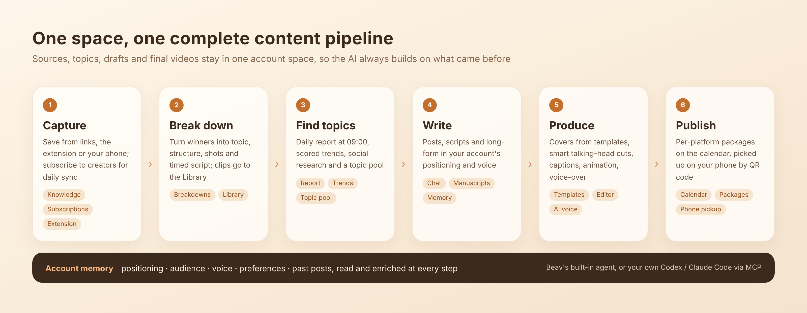

## Spot it on your phone, finish on your computer, post from your phone

Ideas show up while scrolling on your phone, the work happens on your computer, and posting happens on the phone again. Beav connects the two: on the same Wi-Fi, a QR code is all it takes, with no phone app to install.

  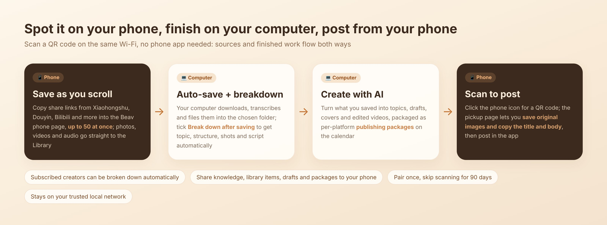

1. **Save from your phone in one step:** click *Phone upload* in the Knowledge base and scan the QR code to open the *Save to Knowledge* page. Copy share links from Xiaohongshu, Douyin, Bilibili, YouTube, Weibo, Zhihu, WeChat and more and paste them in, share text included, up to 50 at once. Photos, videos and recordings from your camera roll can go straight to the Library. Pair once and bookmark the page for 90 days.
2. **Broken down as soon as it lands:** tick *Break down after saving* and your computer downloads, transcribes and breaks each item into topic, structure, shot rhythm, shooting script and timed original script, with clips saved to the Library. Turn on *Auto-break down new posts* for subscribed creators and their updates arrive already analyzed.
3. **Create with AI on your computer:** turn what you saved into topics, drafts, covers and edited videos, packaged for each platform.
4. **Scan to post from your phone:** click the phone icon on a publishing package, manuscript or knowledge card, scan, then save the original images to your photos and copy the title and body in one tap. Images, videos, documents and whole folders can be sent to your phone the same way.

<table>
  <tr>
    <td width="50%">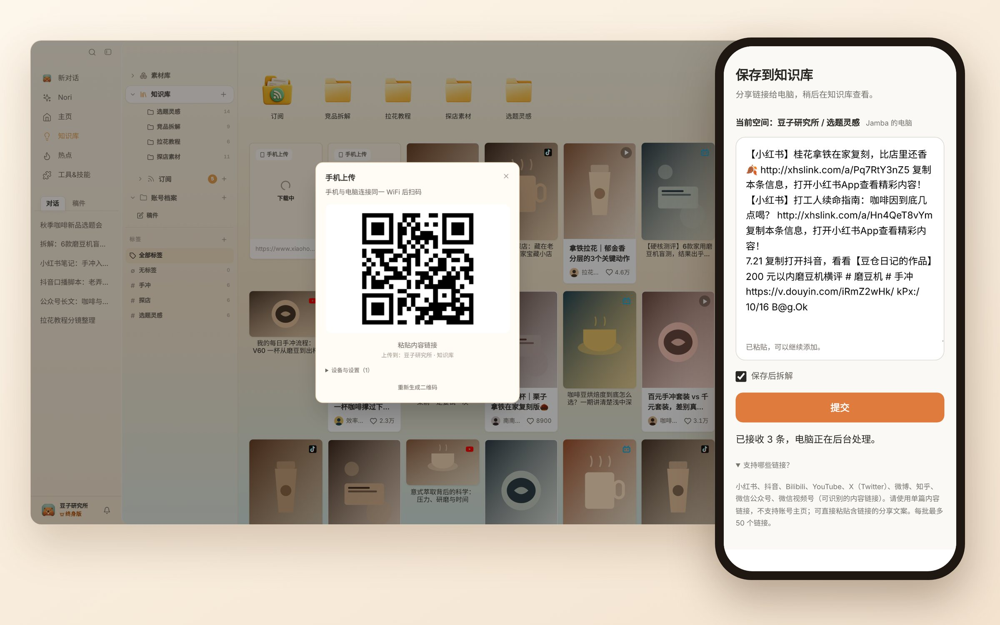</td>
    <td width="50%"></td>
  </tr>
  <tr>
    <td align="center">Spotted on the phone: paste links to save and break down on your computer</td>
    <td align="center">Done on the computer: scan to your phone, save images and copy the text</td>
  </tr>
</table>

## Open Home and know what to do today

- **Session board:** AI works in the background; you only watch three columns. *Needs you* holds questions the agent stopped to ask, *To review* holds finished work waiting for your sign-off, and *In progress* shows what is still running. Click a card to keep chatting in a drawer without leaving Home.
- **Content schedule:** see what goes out this week, what is still a draft and what is overdue. Switch between month, week and year views, drag to reschedule, and use holidays shown on the calendar for timely topics.
- **Mini apps:** built-in tools and the custom tools you asked the AI to build, one click away.

  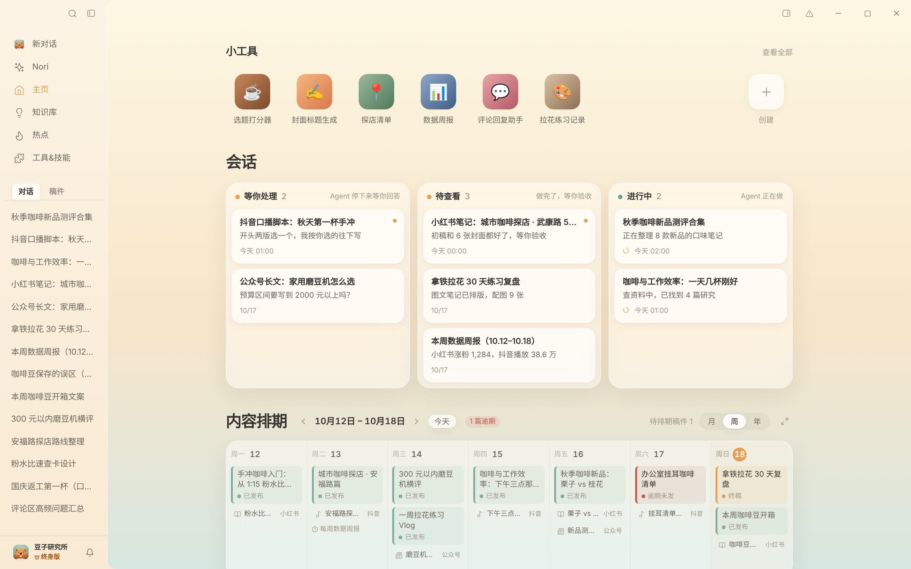

<table>
  <tr>
    <td width="50%">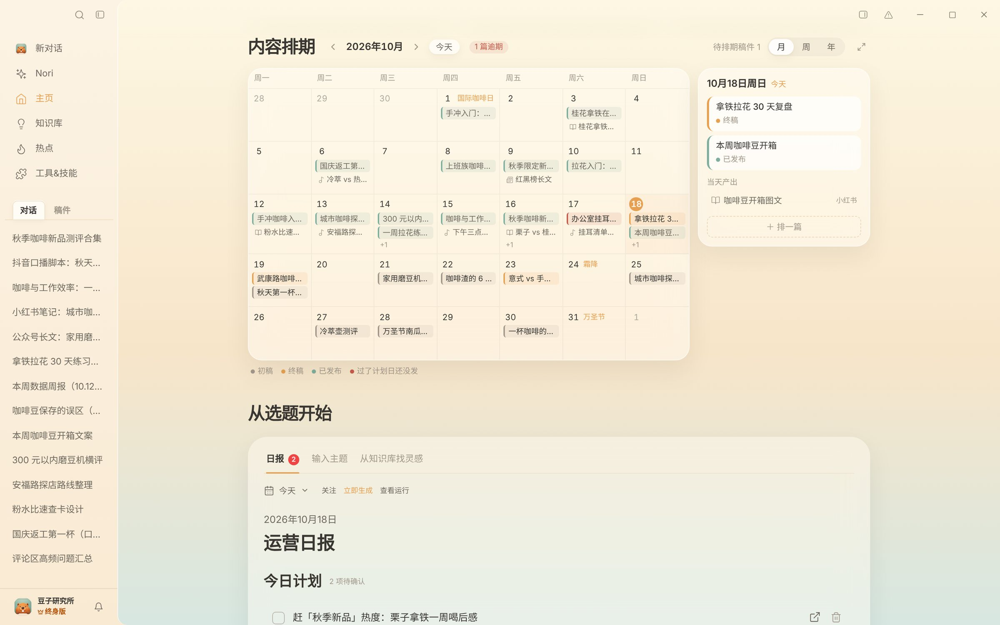</td>
    <td width="50%">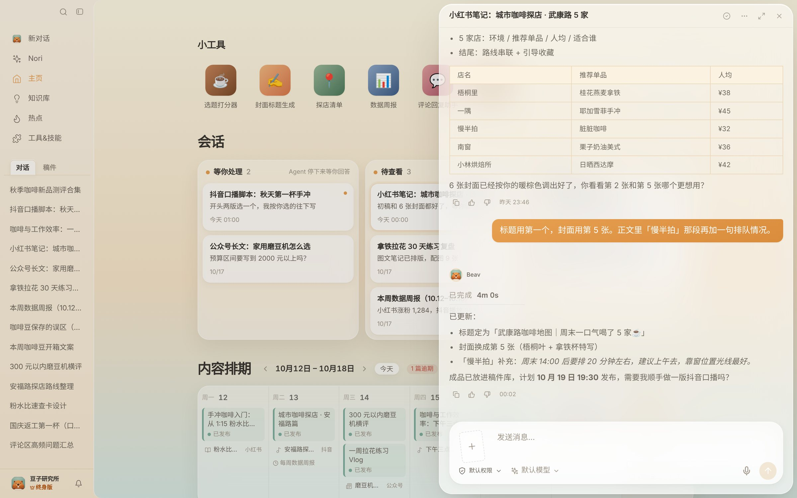</td>
  </tr>
  <tr>
    <td align="center">Month view with status and daily outputs</td>
    <td align="center">Review and continue a session in the side drawer</td>
  </tr>
</table>

## Find topics that fit your account

- **Daily report:** every day at 09:00, a plan and a list of findings matched to your account, each with source links and a one-click "start creating".
- **Trends:** *For my account* scores trending topics by fit and shows where each one ranks on each platform, next to the hot lists of Xiaohongshu, Douyin, Bilibili, Weibo, Zhihu, Baidu and Toutiao. Discuss a trend with the AI or save it to your topic pool.

  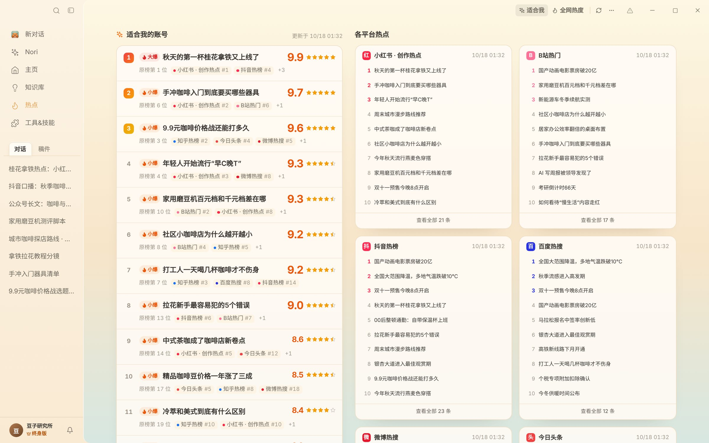

## Write with an AI that knows your account

Describe the goal in a new conversation, such as "use my autumn coffee research to write a Xiaohongshu post". The agent reads your saved sources and account profile, writes a complete platform-ready piece (title, body, hashtags and images when needed) and delivers a **publishing package** you can preview, mark as published or publish from the side panel.

- **Visible steps:** every step and tool call is shown in the conversation; long tasks can be stopped and resumed.
- **Asks instead of guessing:** when your decision is needed, a question card appears above the composer. Pick an option or press a number key, or skip to let the AI choose the recommended option.
- **Manuscripts as documents:** an Obsidian-style live-preview editor with autosave and an AI side panel for rewriting openings and titles.
- **Learns your voice:** let the AI study a batch of your past posts; long-term preferences carry over into later tasks.

  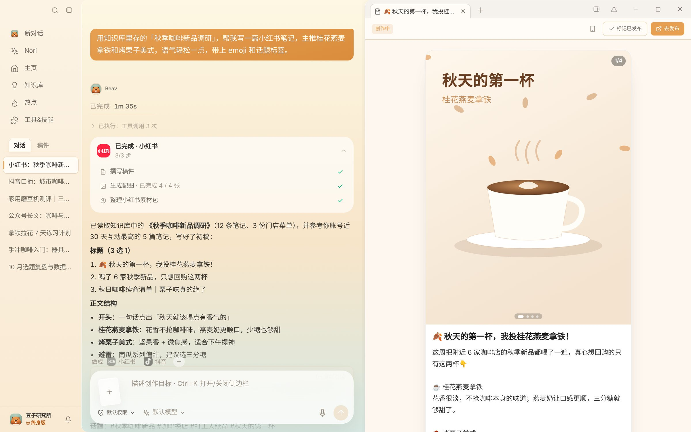

<table>
  <tr>
    <td width="50%">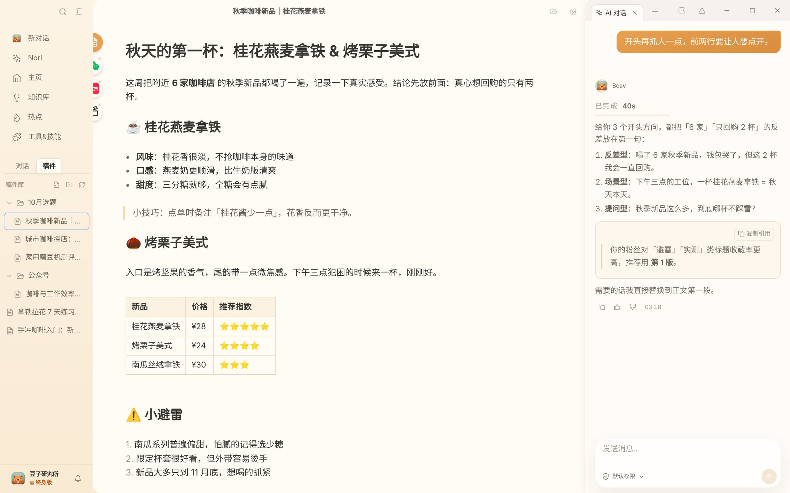</td>
    <td width="50%">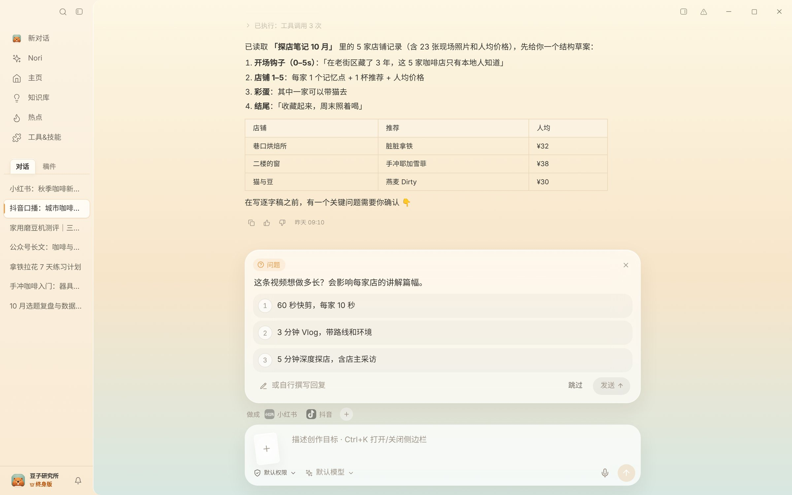</td>
  </tr>
</table>

## Images and video without switching apps

**Images and covers:** the template library sits under every new conversation. Filter by industry and use (cover, image, Xiaohongshu, video), click *Use template*, fill in the text and swap reference images. You can also turn any image you like into your own reusable template.

  

**Smart talking-head cut:** hand your raw recording to the AI with one sentence about the goal. It transcribes word by word, uses meaning and pauses to find filler words, retakes and redundant sentences, and lays them out as a reviewable cut plan. Once applied to the timeline, it adds captions, highlight text, picture-in-picture and explainer animations.

**Full editor:** multi-track timeline, caption track, text and effects tracks, picture-in-picture, keyframes, transitions, color, audio and voice denoising. The AI assistant can keep editing the current project, every change is undoable, and you can export the video or SRT / WebVTT captions with progress shown.

<table>
  <tr>
    <td width="50%">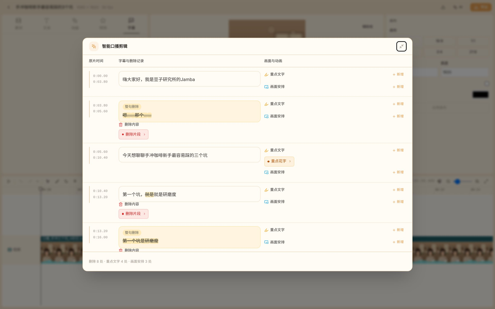</td>
    <td width="50%">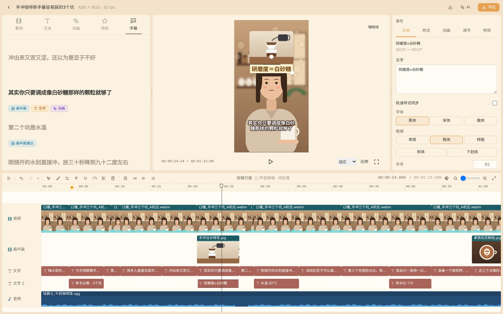</td>
  </tr>
</table>

AI voice-over (including multilingual), image-to-video and video templates are also available from any conversation.

## Build up your sources: Knowledge and Library

- **Knowledge:** save links from Xiaohongshu, Douyin, Bilibili, YouTube, X, Weibo, Zhihu, WeChat articles and more, or link local folders, Obsidian and Eagle. Videos are downloaded and transcribed, and comments can be saved too.
- **Breakdowns:** tick *Break down after saving*, or click *Break down* on any item, to get topic, structure, shot rhythm, shooting script and the timed original script. The clips go straight into the Library.
- **Creator subscriptions:** follow benchmark accounts, sync new posts daily, and optionally break them down automatically within a daily quota.
- **Library:** a Finder-style home for images, videos, copy, music, prompts and topics, with folders, multi-select drag and drop, context menus, space-bar preview and phone upload. Everything is understood by AI (transcripts, breakdowns, visual index) so a single sentence can find it later.

  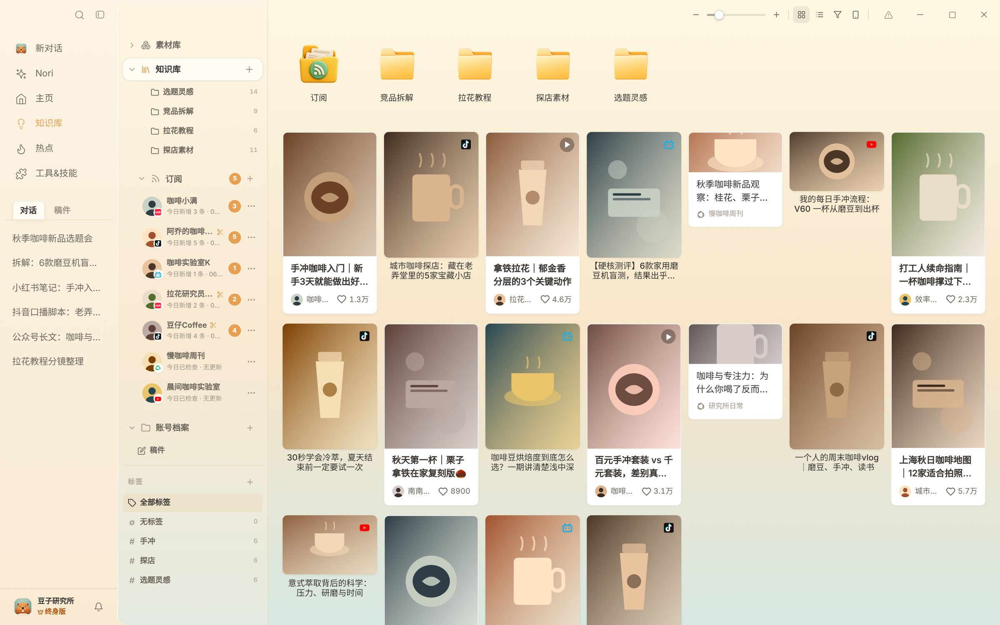

<table>
  <tr>
    <td width="50%">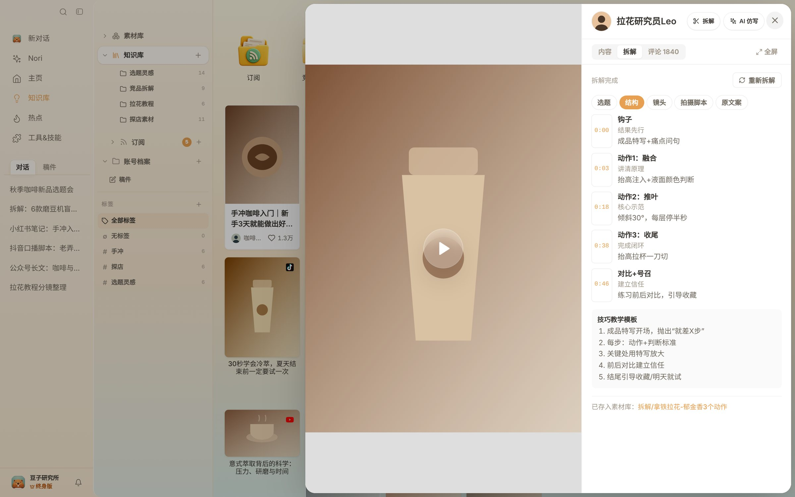</td>
    <td width="50%">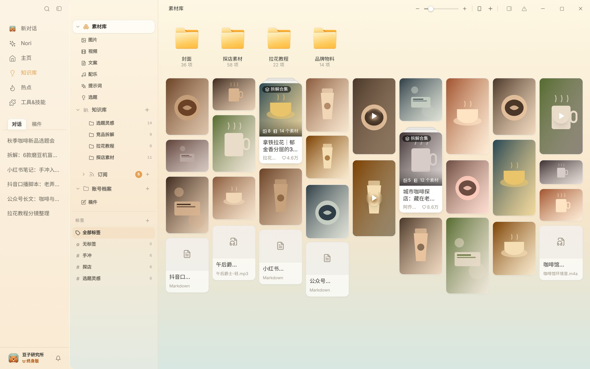</td>
  </tr>
</table>

## Bring your own agent

Already using Codex, Claude Code, WorkBuddy, Claude Desktop or Cursor? Open *Connect Agent*, pick the tool and click *Connect*. Beav writes that tool's MCP configuration for you: no plugin, no terminal. Start a new conversation in the tool and it can:

- search, read and save to Beav's library, knowledge base, account profiles and manuscripts;
- hand creative tasks to Beav's agents, or write finished work back into Beav;
- share the same account memory and creative preferences.

Prefer Beav as an AI-powered source library only? Switch to **Library mode** from the avatar menu (⌘⇧M). Chat and creation entries fold away, leaving Library, Trends and Calendar for the agent you already use. Beav also serves a local library web page that opens right inside the side panel of tools such as Codex.

<table>
  <tr>
    <td width="50%">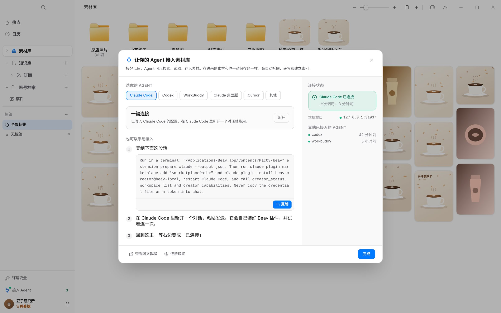</td>
    <td width="50%"></td>
  </tr>
</table>

## Mini apps and the skill marketplace

- **Mini apps:** batch video-copy extraction, link downloads, transcription, AI voice-over, AI metadata removal, image to Live Photo, account planning, and custom tools the AI builds for you.
- **Skill marketplace:** research and topics, trend tracking, writing styles, script polishing, image and video production, installed with one click.

<table>
  <tr>
    <td width="50%">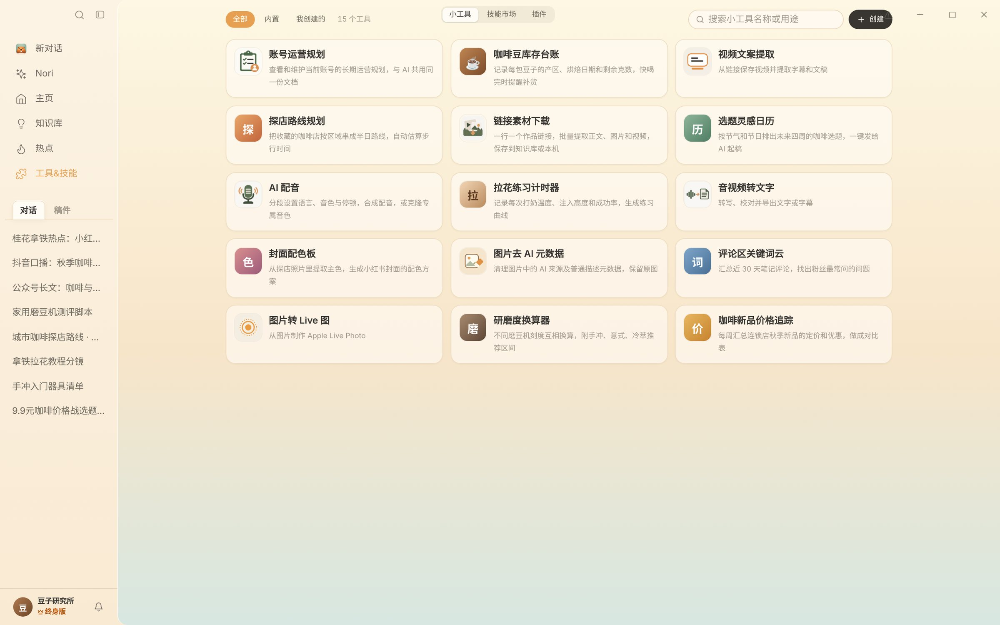</td>
    <td width="50%">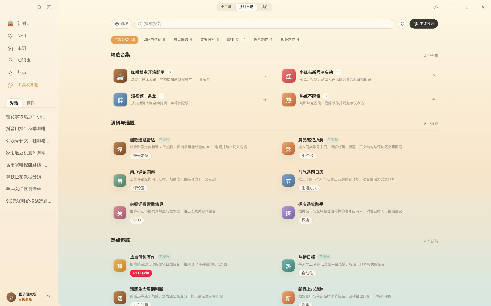</td>
  </tr>
</table>

## Who it is for

- **Solo creators running one account:** one space per account; save posts from your phone as you scroll and let them be broken down automatically, read the report and trends, write and design in conversation, schedule, and pick up on your phone. Beav remembers your positioning, voice and past posts so topics don't repeat.
- **Talking-head and knowledge video creators:** break down winners in your niche, write the script, record, and let the smart cut remove filler before adding captions, highlights and animations.
- **Xiaohongshu and WeChat writers:** subscribe to benchmark accounts, turn frequent comment questions into topics, produce covers and carousels from templates, and send WeChat drafts directly.
- **Multi-account operators and small teams:** separate spaces keep sources, memory and manuscripts apart; switch with ⌥⌘1–9 and let scheduled tasks (weekly reports, topic radars) run on the calendar.
- **Codex / Claude Code users:** use Library mode and *Connect Agent* so your own AI can use Beav's sources and write back finished work.
- **Server deployment:** the Linux server edition is accessible from a browser, ideal for an always-on machine running syncs and scheduled tasks.

## Quick start

1. Install Beav from the [download page](https://beav.pro/download) (macOS / Windows / Linux).
2. Create a **space** for your account or brand and paste your profile link so the AI can set up positioning and memory in a conversation.
3. Open `Settings → AI` to use the official AI service or configure your own model provider.
4. Save a few benchmark posts or subscribe to a few creators. For one-click web capture, get the Chrome / Edge extension from the [latest Release](https://github.com/Jamailar/Beav/releases/latest).
5. Pick a direction from the report, trends or topic pool and describe your goal in a new conversation.

Not sure where something is? Ask Beav in a conversation; it checks the built-in user guide for your version.

> Some new features ship gradually; the installer you have may differ from this page. See the [changelog](./CHANGELOG.md) for details.

## Trust and boundaries

- **Local-first:** sources, manuscripts and projects live in local workspaces, and each space can choose its own storage location.
- **Model choice:** use the official AI service or your own provider.
- **You stay in control:** paid generation, settings changes and publishing are confirmed by you; the AI asks when unsure.
- **Transparent releases:** installers, extensions, updater assets and signatures are published through GitHub Releases.
- **Public boundaries:** review the license, [changelog](./CHANGELOG.md), [roadmap](./ROADMAP.md) and [Issues](https://github.com/Jamailar/Beav/issues).

## Community

- [Website and downloads](https://beav.pro/)
- [GitHub Releases](https://github.com/Jamailar/Beav/releases)
- [Issues](https://github.com/Jamailar/Beav/issues)
- [Bilibili video tutorial](https://www.bilibili.com/video/BV12LNn6nEem/)

Beav is independently developed and maintained by [JambaHailar](https://x.com/JambaHailar).

## License

[MIT License – Non-Commercial Use Only](./LICENSE). Commercial use requires prior written permission from the author.
